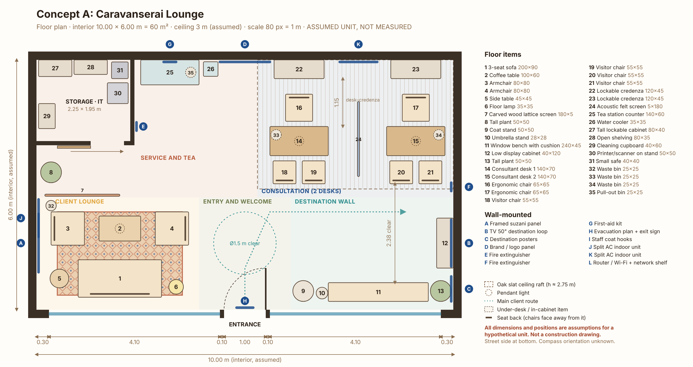

# Phase 1: Concept A "Caravanserai Lounge" (design brief)

> **Status: proposal awaiting approval.** The rental unit is hypothetical: a 10.00 × 6.00 m (60 m²) ground-floor shop unit with a 10 m glazed street front and a 3.0 m ceiling. **Every dimension, price and compliance note here is an assumption until measured or verified in Tashkent.**

Source of truth: [`data/layouts/concept-a.json`](../../data/layouts/concept-a.json). The plan above is generated from that file (`node tools/render-plan.mjs`), and Phase 2 builds the 3D scene from the same data.

---

## 1. Design intent in one sentence

A visitor steps in from the street onto a warm wooden floor, sees a calm lounge with an Uzbek carpet on the left and a bright destination wall on the right, and a consultant at the back looks up and says hello. Nobody has to walk past a counter or a barrier.

## 2. Zones

| Zone | Area (approx.) | Contents | Why it is here |
|---|---|---|---|
| **Client lounge** (front left) | 3.9 × 2.7 m ≈ 10.5 m² | 3-seat sofa (back to the window), 2 armchairs, coffee table, 3 × 2 m Uzbek carpet, side table with USB charging, floor lamp, framed suzani on the side wall, AC unit 1 | Visible from the street, so it works as the shop window. Natural daylight. Families wait together here. |
| **Entry and welcome** (front centre) | 2.2 × 2.7 m | Ø1.5 m clear turning circle, entrance mat, evacuation plan and exit sign by the door. Brand panel on the back wall, straight ahead on the entry axis | Uncluttered first 3 m, so nothing blocks the door, and the brand is the first thing seen on a 6 m line of sight. |
| **Destination wall** (front right) | 3.9 × 2.7 m | 50″ TV running a destination loop, editable posters, low display cabinet, 2.4 m window bench (overflow seating plus plants), coat and umbrella stand, plant | Inspiration while waiting. Doubles as the main aisle to the desks (2.38 m clear). |
| **Consultation** (back right) | 4.7 × 3.3 m ≈ 15.5 m² | 2 desks 140 × 70, ergonomic chairs, 2 visitor chairs each, lockable credenzas behind, 1.8 m acoustic felt screen between the desks, oak slat ceiling raft, pendant over each desk, AC unit 2 on the back wall | Staff face the entrance and can greet clients. The ceiling raft creates a cosy "room within a room" without walls. |
| **Service and tea** (back left) | ≈ 13 m² incl. storage | Storage/IT room 2.25 × 1.95 m (sliding door): MFP printer, safe, tall cabinet, shelving, cleaning cupboard, router, staff coat hooks. Outside: tea counter with under-counter fridge and pull-out bin, water cooler, first-aid kit, fire extinguisher | Hidden behind a carved lattice screen and out of the client's direct view. Staff reach tea and the printer in under 5 m. |

## 3. Verified geometry (self-consistency of the model only)

`node tools/validate-layout.mjs` → **15/15 checks pass**:

- All 36 items inside the room, no collisions among 32 floor items and the partitions.
- Main door swing (1.0 m inward) and the Ø1.5 m turning circle inside the entrance are clear.
- Desk to credenza (staff chair zone) 1.15 m (target ≥ 1.0 m). Sofa to coffee table 0.45 m (target ≥ 0.40 m).
- Walkable routes from the entrance, found by grid search with obstacles grown by half the route width:

| Route | Required | Widest passable |
|---|---|---|
| To desk 1 and desk 2 (client aisle) | 1.20 m | 1.25 m* |
| To lounge | 0.90 m | 1.00 m* |
| To tea station / storage door | 0.90 m | 0.95* / 1.15 m |
| Into storage to the printer | 0.75 m | 0.75 m (sliding door ≈ 0.80 m opening) |
| To staff chair 1 / staff chair 2 | 0.90 / 0.60 m | 1.30 / 0.60 m |

\* Limited by how close the target point is to furniture, not by the aisle itself. The main front aisle is 2.38 m clear.

**Known tight spots, flagged honestly:**
1. **Staff chair 2** is reached through a 0.60–0.65 m gap between the acoustic screen and desk 2. That is acceptable for one staff member, not for clients. Alternative: shorten the screen or use a 1.2 m desk.
2. **The storage room is 4.4 m².** It fits the listed items but has no spare space. A deeper real unit could take 2.5 × 2.0 m.
3. These targets (1.2 m main aisle, 0.9 m secondary, Ø1.5 m turning circle) are **common international planning guidance, not checked against Uzbek ShNQ/KMK norms.**

## 4. Mood, materials and palette

Principles taken from your reference photos: a warm timber ceiling raft over the work zone, zoning by floor finish, a curved and friendly furniture language, café-style seating rather than "across-the-counter" seating, and warm pendant lighting. **Replaced:** their brand colours (yellow/blue), brochure walls, and cool white retail lighting.

| Role | Colour | Material (cost-conscious real-world suggestion) |
|---|---|---|
| Main walls | Ivory `#F4EEE4` | Washable matte interior paint |
| Feature wall (lounge side) | Sand `#E3D3BB` | Textured decorative plaster (ganch-inspired, restrained, no carving) |
| Floor | Warm oak `#B9874F` | Commercial LVT / class 33 laminate, oak look |
| Ceiling raft and desk tops | Oak `#B9874F` / Walnut `#6B4A2F` | Oak-veneer slats on black acoustic felt |
| Upholstery | Terracotta `#B85C3C`, Sand | Durable fabric, Martindale ≥ 30 000 for commercial use |
| Accent 1 | Rishtan cobalt `#1F4E8C` | Ceramic tea set, cushions, brand-wall background (editable) |
| Accent 2 | Samarkand turquoise `#2A8C8C` | Destination wall graphics, small ceramics |
| Accent 3 | Saffron `#E0A43A` | Cushions, pendant shades, signage highlight |
| Greenery | Olive `#6E7B4E` | 2 tall plants (ficus/olive), window-bench plants (pothos, sansevieria) |

**Uzbek accents: four touches, no more.** (1) One carpet in the lounge, (2) one framed suzani panel, (3) one carved/CNC lattice screen with a girih-style geometric pattern, (4) Rishtan-style ceramics at the tea station. In the 3D model, suzani and carpet patterns will be **generated procedurally**, not copied from photographed artworks.

## 5. Lighting concept (to refine in Phase 3)

- **Colour temperature:** 3000 K throughout, CRI ≥ 90 so skin tones and fabrics look natural.
- **Targets** (common guidance, verify): desks ≈ 500 lux, lounge 200–300 lux and dimmable, circulation ≈ 200 lux.
- **Fixtures:** about 12 recessed downlights, 3 pendants (2 desks + lounge), floor lamp, LED strip washing the destination wall, window display lighting.
- **Switch groups by the entrance:** (1) window and sign (timer), (2) general front, (3) desks, (4) lounge dimmer, (5) storage (local switch). Emergency/exit lighting to be checked against local fire rules.

## 6. Power, data and climate (indicative, about 20 points)

| Location | Points |
|---|---|
| Each desk | 4 × power (laptop, monitor, phone, lamp) + 1 data |
| Lounge | 2 × power with USB-A/C at the side table |
| Destination wall | TV power + data, display-cabinet power |
| Tea station | **Dedicated circuit**: kettle (≈ 2 kW) + fridge + water cooler |
| Storage/IT | MFP, router/ONT, 2 spare. A small UPS is recommended. |
| Window | Display and sign power on a timer |

**Climate:** Tashkent summers regularly exceed 40 °C. Heat gain from 60 m² with 8 m of glazing suggests roughly 6–7 kW of cooling (rule of thumb, not an engineering calculation), shown as 2 split units. **Prefer a unit that already has AC.** Ask how it is heated in winter (central radiators or heat pump). Fresh-air ventilation needs checking because split ACs only recirculate.

## 7. Acoustic privacy strategy (no closed consultation room)

Felt screen between the desks, felt-backed slat ceiling raft, carpet and upholstered lounge furniture, soft background music, and desks 2.8 m apart. For passports and payments the consultant can use the desk furthest from the door. **Optional upgrade:** if the real unit is deeper than 6 m, add a 2.4 × 2.4 m glazed private room in place of the back-left zone (Concept B module).

## 8. Interface languages

The app UI will support **English, Uzbek (Latin script) and Russian**, switchable at runtime, with all text in translation files. Brand, signage and poster text are user-editable in any language, using a bundled font that covers Latin, Uzbek oʻ/gʻ and Cyrillic. The draft translations below **need review by a native speaker**:

| English | Oʻzbekcha | Русский |
|---|---|---|
| Floor plan | Qavat rejasi | План этажа |
| Walk mode | Yurish rejimi | Режим прогулки |
| Furniture | Mebel | Мебель |
| Materials | Materiallar | Материалы |
| Save version | Versiyani saqlash | Сохранить версию |
| Undo / Redo | Bekor qilish / Qaytarish | Отменить / Повторить |
| Duplicate / Delete | Nusxa olish / Oʻchirish | Дублировать / Удалить |
| Budget | Byudjet | Бюджет |
| Collision warning | Toʻqnashuv ogohlantirishi | Предупреждение о пересечении |

## 9. Decisions I need from you (approve or change)

1. **Layout approval:** lounge front-left, desks back-right facing the entrance, storage and tea back-left. Approve, or say what to move.
2. **Sofa orientation:** back to the window (street sees the back of the sofa, clients face into the office), or facing the window?
3. **Budget scope:** does the $10,000 include AC units, computers/laptops, exterior sign permits and the first month's rent/deposit? The draft budget below **excludes** them.
4. **Exterior sign:** a lightbox is assumed. Its size and permit rules are unknown and depend on the landlord and city.
5. **Door swing:** inward (as drawn) or outward. This depends on local egress rules and the actual shopfront.
