# Phase 2: navigable 3D foundation (report)

> **Status: built and tested, awaiting your review.** The space is still the *assumed* 10 × 6 m unit from Phase 1. Furniture is **placeholder geometry**: correctly sized blocks, not final models. Materials, Uzbek accents and realistic lighting are Phase 3.

## What works now

| Area | Implemented |
|---|---|
| **Room shell** | Floor, ceiling, 0.2 m exterior walls, aluminium shopfront with mullions and glazing, 1.0 m glass entrance door (inward swing, animated open/close), storage-room partition with sliding door, oak slat ceiling raft, downlight discs |
| **Generated from data** | Everything is built from `data/layouts/concept-a.json`, the same file that draws the Phase 1 plan, so the plan and the 3D scene cannot drift apart |
| **Placeholder furniture** | All 36 items at their real dimensions: seats with backrests showing which way they face, desks and tables with legs, plants, slender floor lamp and coat stand. Click any item to see its name and size |
| **Wall items** | TV, posters, suzani panel, brand panel, 2 extinguishers, first-aid kit, 2 AC units, router, evacuation plan, staff hooks, 3 pendants |
| **Outside** | Pavement, road, placeholder lightbox sign, entrance mat |
| **Orbit** | Rotate, pan, zoom (mouse and touch) |
| **Walk** | First person: WASD / arrows, Q/E turn, Shift run, mouse-look with pointer lock (click the view), drag-to-look fallback. Collision with walls, glazing, partitions, furniture and the door leaf (radius 0.25 m) can be switched off. Eye height 1.0–2.0 m and speed 0.5–4 m/s are adjustable |
| **Plan** | Top-down orthographic view with pan and zoom, street at the bottom, room dimensions, optional zone overlay and 0.5 m grid |
| **Dollhouse** | Elevated view. Walls facing the camera are cut away automatically and leave a low wall stub so the outline stays readable |
| **Wall display** | Cutaway / solid / transparent / hidden. Ceiling auto (shown only when walking) / on / off |
| **Camera presets** | Overview, dollhouse, floor plan, street, entrance, client lounge, client-at-desk (seated eye 1.2 m), consultant view, tea and storage, destination wall. "Reset view" plus shortcuts 1–4, R, H |
| **Room editing** | Width 5–16 m, depth 4–12 m, ceiling 2.5–4.5 m. Walls, shopfront windows (re-derived around the door), partitions, zones and ceiling raft rebuild safely. **Furniture is never moved silently**: items left outside the room turn red and the panel shows a warning |
| **Languages** | English, Oʻzbekcha (Latin), Русский, switchable at runtime. UZ/RU are draft translations for native review |
| **Quality** | Low / Balanced / High (pixel ratio, sun shadows on/off, shadow resolution, number of fill lights). Automatic step-down if FPS stays below 24 for 3 s (can be switched off). Optional FPS counter |
| **Offline** | No CDN fonts, HDR files or remote assets. The lighting environment is procedural |

## Tests run in this phase

| Check | Result |
|---|---|
| `npm run typecheck` | Pass |
| `npm test`: 18 unit tests (wall splitting around openings, partitions, door leaf, collision stop / slide / no tunnelling, walking through the default layout, room resize and clamping, presets in bounds) | 18 / 18 pass |
| `npm run build`: production build | Pass (single 1.28 MB JS bundle, 358 kB gzipped) |
| `npm run test:e2e`: headless Chromium against the build | See the end of this file |

## Screenshots

All captured automatically by the end-to-end test from the running app, in `screenshots/`.

| | |
|---|---|
| 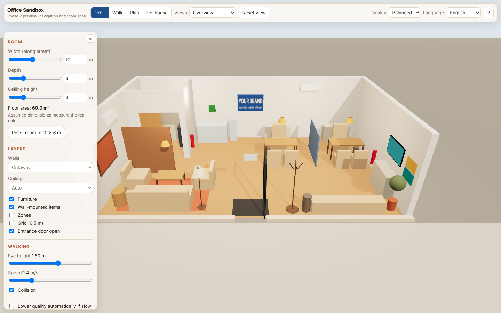 Orbit overview | 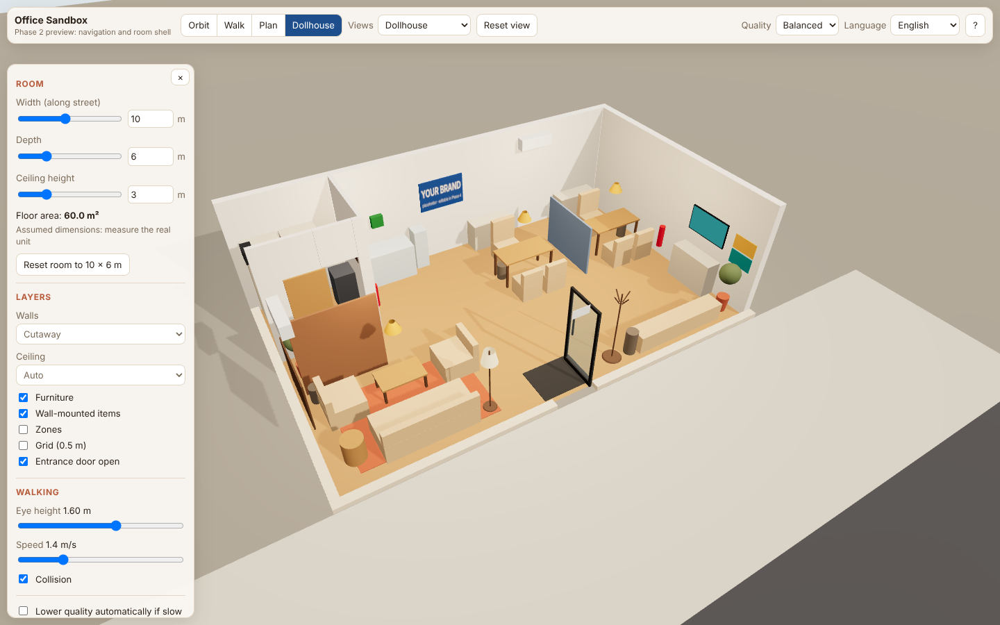 Dollhouse (front walls cut away) |
| 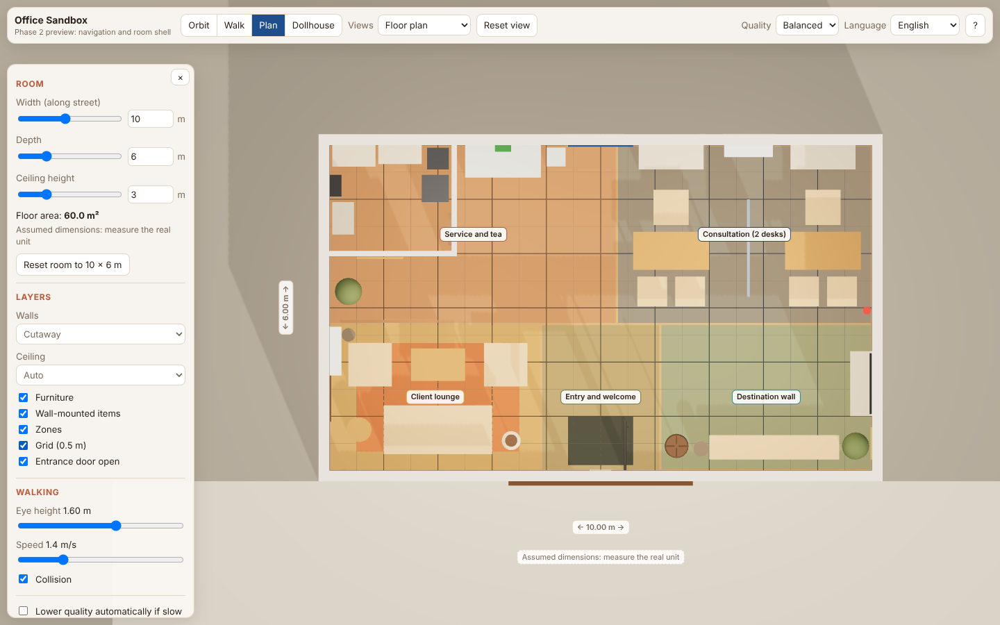 Plan with zones and grid | 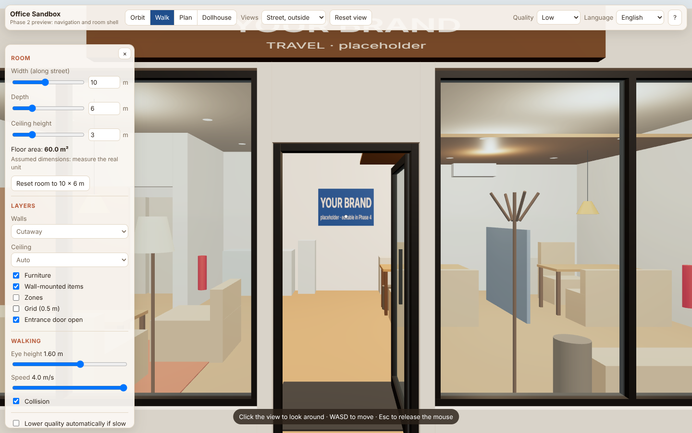 Walk: street, outside |
| 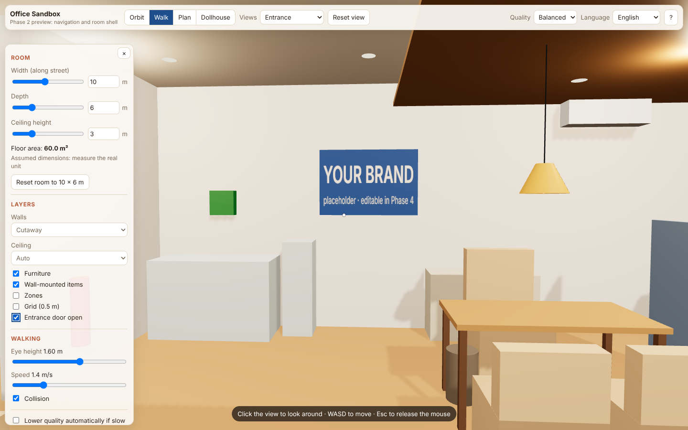 Walk: entrance | 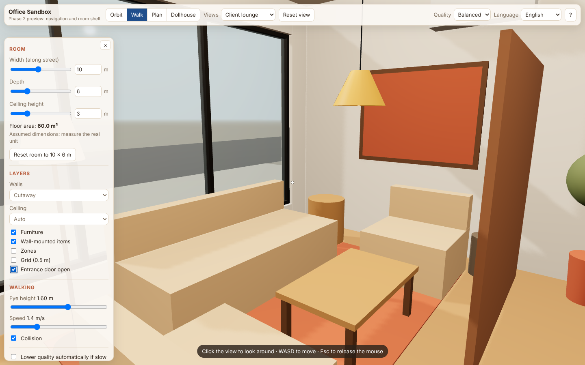 Walk: client lounge |
| 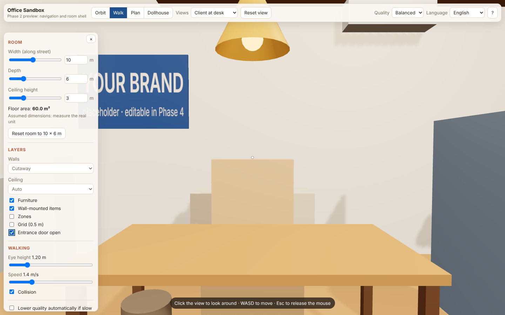 Seated client at desk 1 | 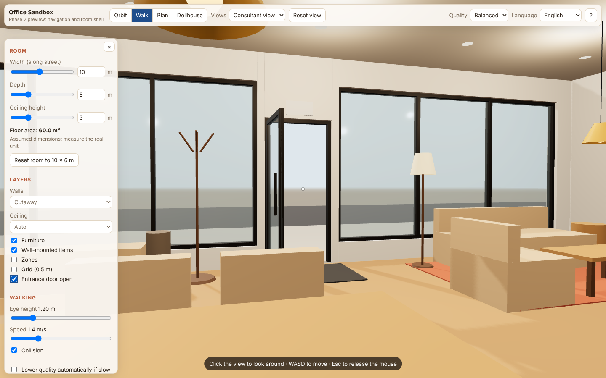 Consultant view to the door |
| 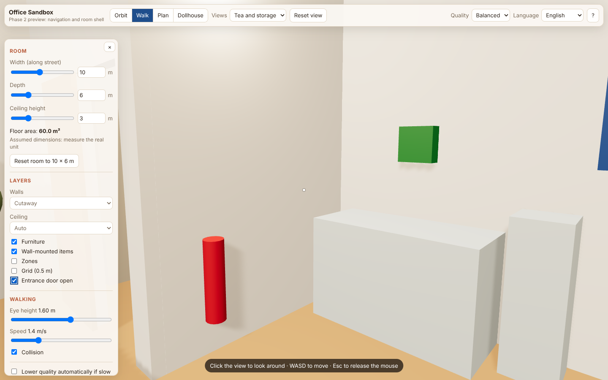 Tea and storage | 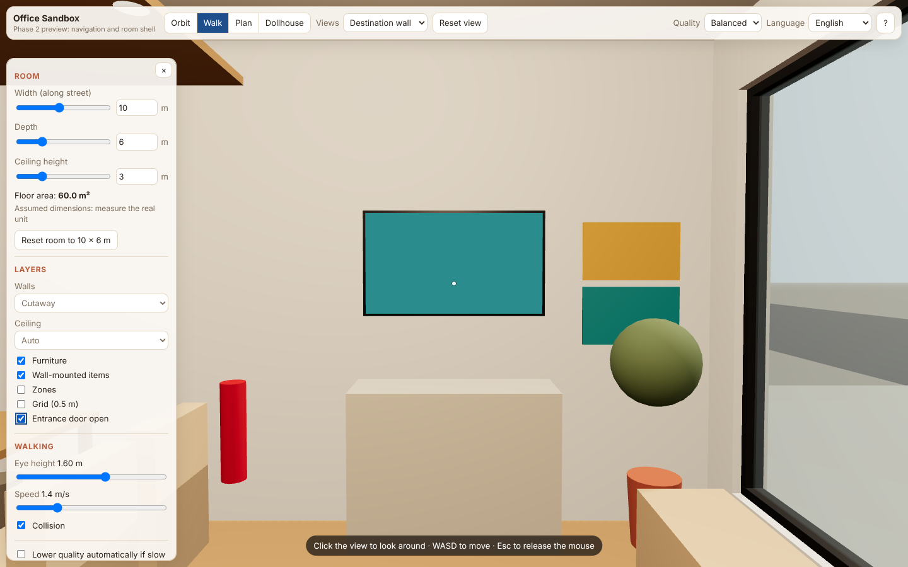 Destination wall |
| 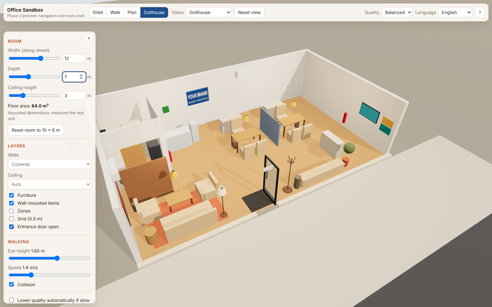 Room resized to 12 × 7 m | 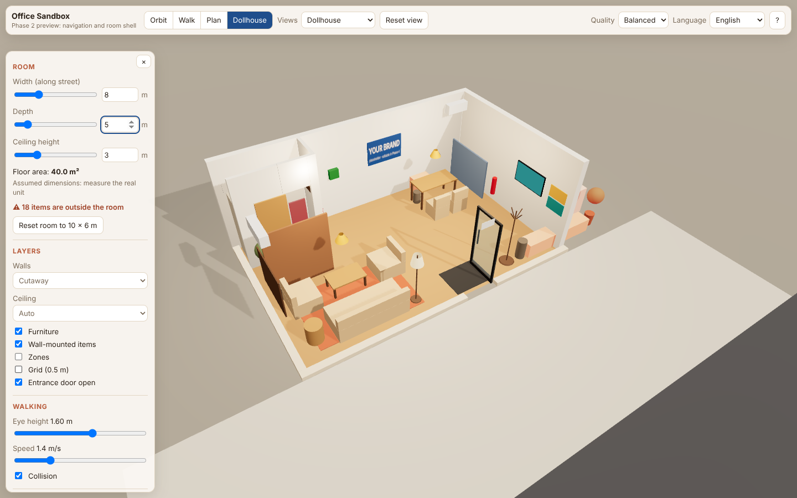 8 × 5 m: furniture outside flagged red |

## Known limitations and honest notes

1. **Performance on your laptop is not yet measured.** This cloud container has no GPU, so headless Chromium renders in software at about 2 FPS. That number says nothing about a real laptop. Please open the app, tick "Show FPS" and tell me the number in Balanced mode. Target: ≥ 30 FPS.
2. **Touch walking:** on phones and tablets you can orbit, use plan and presets, and drag to look in walk mode, but there is no on-screen joystick for moving yet (Phase 5).
3. **Lighting is functional, not realistic.** One sun, hemisphere light and a few unshadowed fill lights. Realistic fixtures, ambient occlusion and materials are Phase 3.
4. **Furniture is not editable yet.** Clicking an item only shows its info. Move, rotate, add and delete are Phase 4.
5. **Room resizing keeps the door's absolute position** and re-derives the two shopfront windows around it. Interior items keep their positions. Camera presets scale with the room.
6. **The JS bundle is large (358 kB gzipped)** because Three.js and Drei are included whole. It loads in about 1–2 s locally. Code splitting is planned for Phase 5.
7. Console shows two warnings from library internals (`THREE.Clock` deprecated inside React Three Fiber). They don't affect anything and will go away when the library updates.

## What I need from you

1. Run it locally (see the root README: `npm install`, then `npm run dev`). Walk around and report the **FPS in Balanced mode** and your laptop model if you can find it (Settings → System → About on Windows).
2. Confirm the **proportions feel right** (aisle widths, desk area, lounge size) before Phase 3 adds detail.
3. Still open from Phase 1: **what does the $10,000 budget include** (AC, computers, rent/deposit)?

## End-to-end test result

`npm run test:e2e`: **17 / 17 checks pass** (headless Chromium, software rendering):

- Canvas renders with a WebGL context. Toolbar switches to dollhouse and plan modes.
- "Street" preset places the walker outside. Holding W walks **through the open entrance door**, and **collision stops the walker at the back wall** (5.750 m, i.e. wall minus 0.25 m body radius).
- With the door closed, the walker **is blocked outside** (−0.300 m).
- Q turns the walker. All interior presets render.
- Room resized to 12 × 7 m: walls rebuild and facade windows are re-derived around the door. Shrinking to 8 × 5 m shows "⚠ 18 items are outside the room". Reset restores 10 × 6 m.
- Russian and Uzbek UI strings load. H opens the controls guide. No horizontal overflow at phone width (390 px).
- **No console or page errors.**

Bugs found and fixed by this test during the phase: after choosing a view from the dropdown or ticking a checkbox, keyboard focus stayed on that control and blocked WASD. Navigation keys now work after any non-text control, and clicking the 3D view returns focus to navigation.
