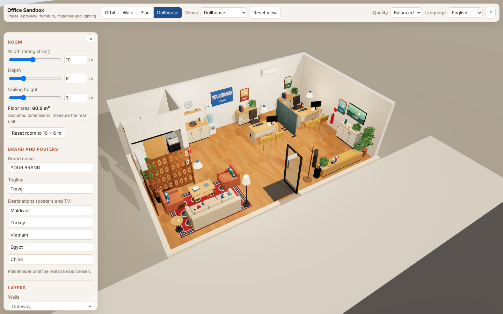
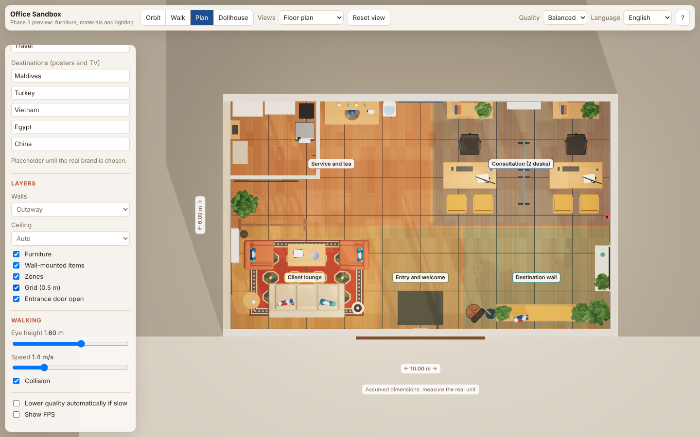
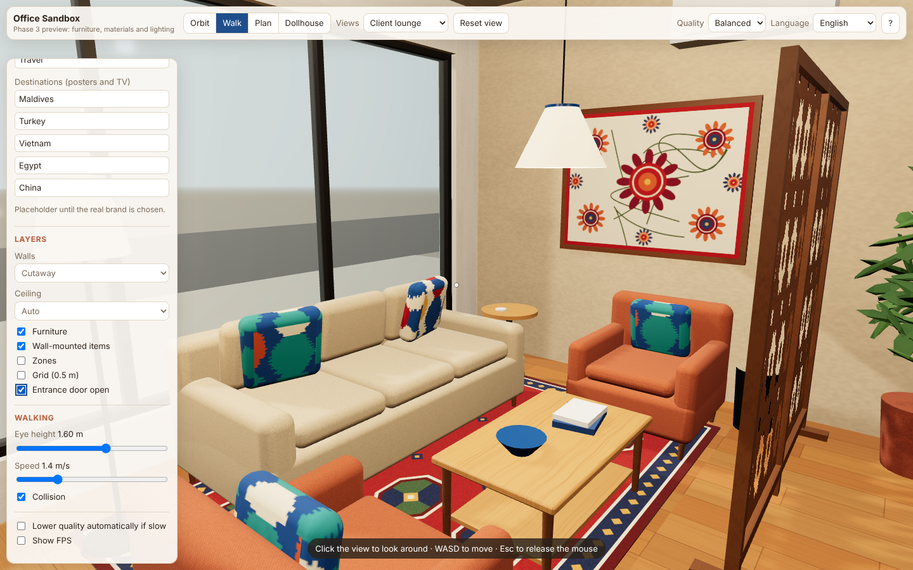
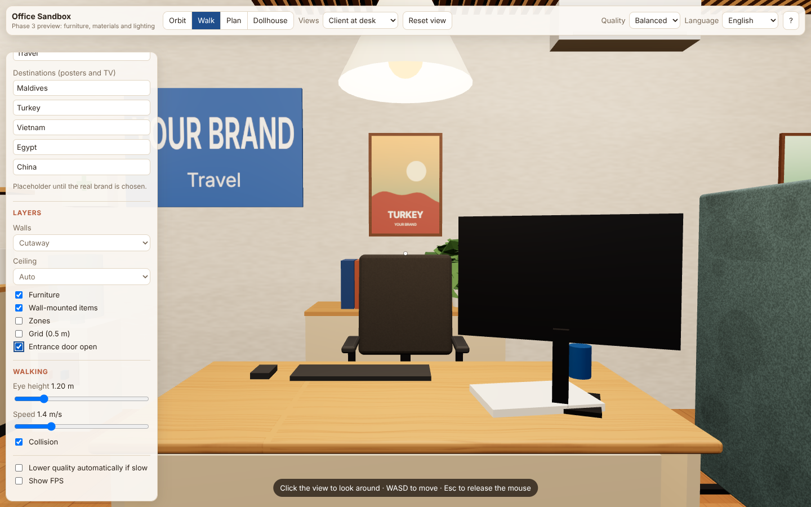
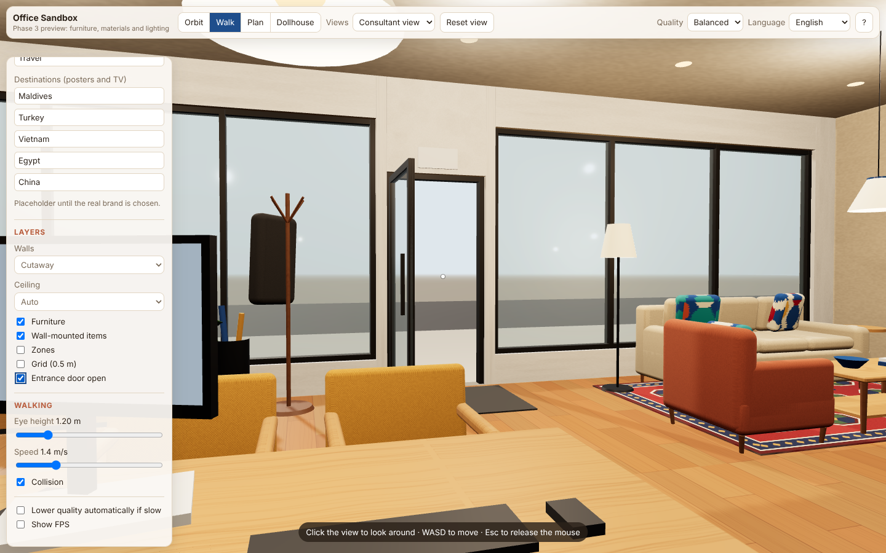
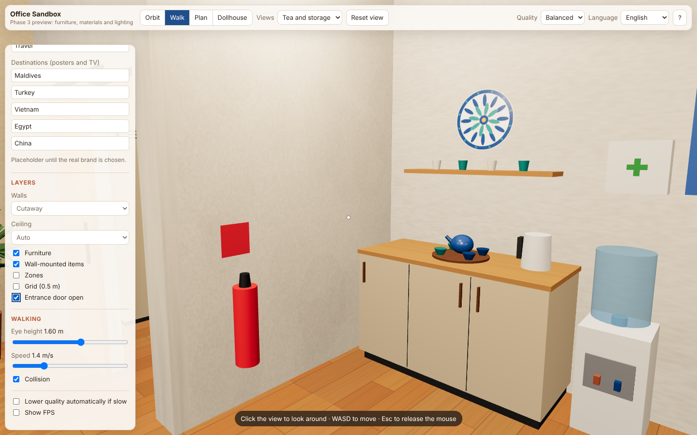
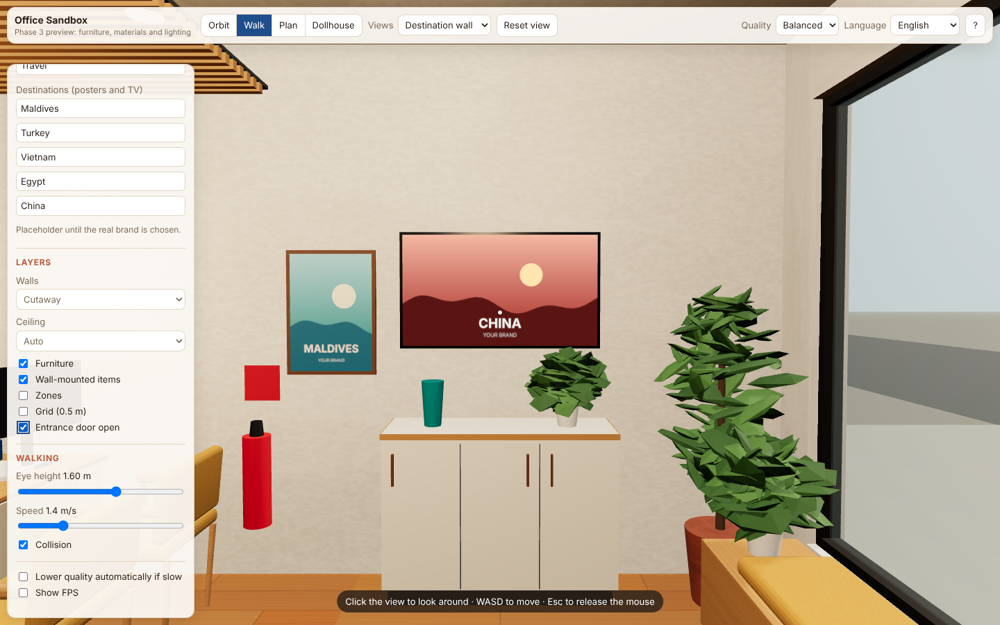
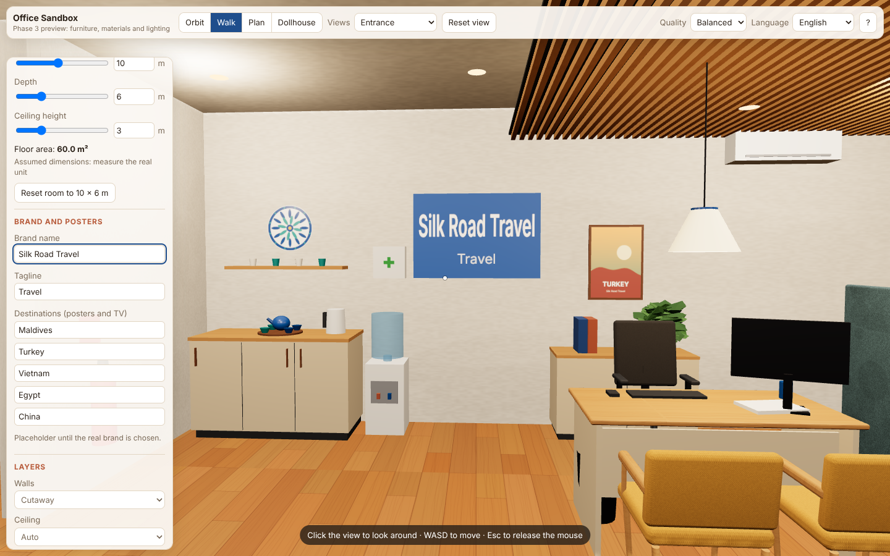

# Phase 3: interior design (report)

> **Status: built and tested, awaiting your review.** The unit is still the *assumed* 10 × 6 m space. Furniture models are **design representations at real sizes**, not specific products. Prices are still placeholders (Phase 1 budget).

## What changed

| Area | Phase 3 result |
|---|---|
| **Furniture** | All 36 placeholder blocks replaced with **parametric models** built from the exact sizes in `data/layouts/concept-a.json`: 3-seat sofa with seat and back cushions, armchairs, coffee table with Rishtan bowl and books, side table with charging pad, floor lamp, desks with side panels, modesty panel, monitor, keyboard and brochures, 5-star ergonomic chairs, upholstered visitor chairs with oak legs, credenzas, window bench with cushion and plants, display cabinet, tea counter, water cooler (19 L bottle), tall cabinet, shelving with binders, cleaning cupboard, printer on stand, safe, bins, coat stand with coat, umbrella stand, plants |
| **Uzbek accents** (four touches, as agreed) | **Carpet** with octagonal gul medallions and diamond borders · **framed suzani** with rosettes and vines · **carved lattice screen** (16-point star pattern, lets light and shadow through) · **Rishtan-style ceramics** (teapot, piyola bowls, decorative lagan plate). Plus ikat/adras cushions |
| **Materials** | Oak plank floor (real plank size: 0.2 × 1.2 m), plaster walls with a **sand feature wall** in the lounge, woven fabrics (sand sofa, terracotta armchairs, saffron visitor chairs), felt acoustic screen, lacquered cabinets, metal, ceramics, glass |
| **Ceiling** | Oak slat ceiling raft (40 mm slats at 80 mm centres on black felt) over the desks |
| **Lighting** | Warm 3000 K ceiling fills, real light sources in the 3 pendants and the floor lamp, daylight through the shopfront (the ceiling now blocks sun correctly), soft **contact shadows** under furniture and along wall bases |
| **Brand and posters** | New side-panel section: edit the **brand name**, **tagline** and **5 destinations**. Updates the brand wall, outside sign, 3 framed posters and the TV (cycles destinations every 6 s). Defaults: Maldives, Turkey, Vietnam, Egypt, China |
| **Quality tiers** | Low: 3 fill lights, no shadows, no contact shadows. Balanced: + pendants and lamp lights, sun shadows 1024 px, contact shadows 1024 px. High: 2048 px shadows and contact shadows, sharper pixel ratio |

All patterns (carpet, suzani, ikat, lattice, lagan, posters) are **generated in code**: no photographs or copyrighted artwork, nothing downloaded, works offline.

## Tests

| Check | Result |
|---|---|
| `npm run typecheck` | Pass |
| `npm test` | **21 / 21** (3 new: every item has a dedicated model; orientation of sideways items) |
| `npm run validate:layout` | 15 / 15 |
| `npm run build` | Pass (369 kB gzipped JS) |
| `npm run test:e2e` | **18 / 18** on the final run. The new check edits the brand name. One earlier run had a single intermittent failure that did not repeat; it is most likely timing in this GPU-less container, where software rendering runs at a few FPS |

## Screenshots (`screenshots/`, captured automatically from the running app)

| | |
|---|---|
|  |  |
|  |  |
|  |  |
|  |  |

## Problems found and how they were handled

1. **Screen-space ambient occlusion (N8AO) crashes with three.js r187.** It threw an error on every frame. It was removed, together with its two packages, and replaced by baked contact shadows. Revisit when the library is updated.
2. The desk monitor blocked the consultant's view of the entrance. It was moved to the far side of the desk.
3. The TV and the first poster showed the same destination. The TV now starts from destination 4.
4. Typing in the brand fields must not trigger keyboard shortcuts (e.g. H for help). Verified by the test.

## Not done yet / honest notes

- **Performance on your laptop is still unmeasured.** Phase 3 adds detail (about 8 light sources and several hundred meshes on Balanced). If it is slow, the app drops to Low automatically, or you can choose Low yourself. Please send the FPS number.
- Lighting is real-time and believable, not photorealistic. There is no global illumination or reflections beyond a simple environment.
- Plants are stylised (flat leaf shapes), not botanical models.
- Furniture is still not movable: that is **Phase 4** (editor: select, move, rotate, add, delete, materials, undo/redo, save/load, JSON).
- Brand and destinations are remembered in your browser only. Proper project saving comes in Phase 4.
